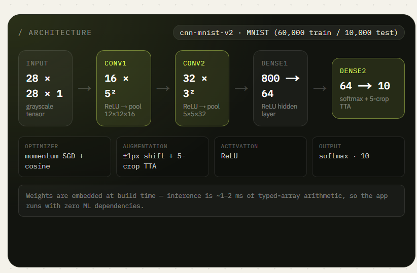
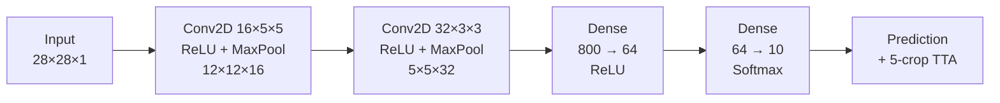
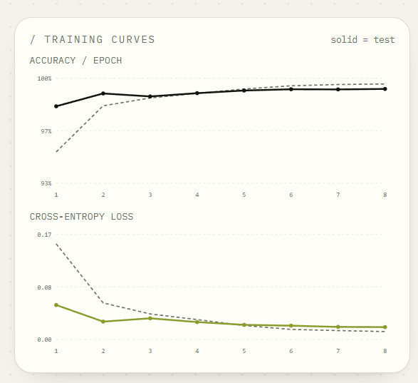
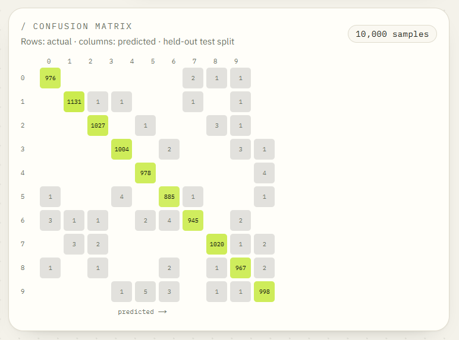

<div align="center">

# DigitLab

### Handwritten Digit Recognition with a CNN built from scratch

Draw a digit or upload a photo, and a 2-block convolutional neural network trained on MNIST reads it in milliseconds.
Every inference is persisted to PostgreSQL, so the app doubles as a labelled evaluation log.

[](https://handwritten-digits-recognition.netlify.app/)
[](#model-performance)


**[Live Demo](https://handwritten-digits-recognition.netlify.app/)** ·
**[Model Card](https://handwritten-digits-recognition.netlify.app/model)** ·
**[History](https://handwritten-digits-recognition.netlify.app/history)**

</div>

---

## Table of Contents

- [Overview](#overview)
- [Features](#features)
- [Model Architecture](#model-architecture)
- [Model Performance](#model-performance)
- [Preprocessing Pipeline](#preprocessing-pipeline)
- [Tech Stack](#tech-stack)
- [Getting Started](#getting-started)
- [Reproducing the Model](#reproducing-the-model)
- [API Reference](#api-reference)
- [Deployment](#deployment)
- [Project Structure](#project-structure)
- [License](#license)

---

## Overview

DigitLab is a complete, end-to-end digit recognition product. There is **no hosted ML service, no TensorFlow.js and no Python at runtime**: the network was trained from scratch in plain JavaScript (forward pass, backpropagation, momentum SGD) and the frozen weights are served by a small TypeScript inference engine using typed-array arithmetic.

| | |
| --- | --- |
| **Test accuracy** | 99.31% on 10,000 held-out MNIST digits (69 errors) |
| **Parameters** | 56,970 |
| **Inference latency** | ~1–2 ms of core arithmetic per forward pass |
| **ML dependencies** | None |
| **Persistence** | Every read stored with its 28×28 tensor, softmax distribution and latency |

---

## Features

| Feature | Description |
| --- | --- |
| **Draw mode** | 280×280 canvas with adjustable brush size, undo and clear. Auto-read fires shortly after you lift the pen. |
| **Upload mode** | PNG/JPG/WEBP photos are letterboxed, auto-inverted, Otsu-thresholded, cropped, rescaled and centred before inference. |
| **Live verdict** | Predicted digit, confidence, margin, full softmax histogram and latency. |
| **Inside the network** | Inspect the preprocessed 28×28 tensor and all 16 pooled 12×12 convolution activation maps. |
| **Unseen MNIST gallery** | One click classifies a held-out test digit and records the ground truth automatically. |
| **Feedback loop** | Mark a read correct or pick the real digit; rows update in PostgreSQL and roll into live accuracy stats. |
| **History** | Filter by source, digit or mismatch; edit ground truth inline; export CSV; delete rows or clear the log. |
| **Model card** | Architecture, training curves, per-class recall, 10×10 confusion matrix and a live re-evaluation of 60 held-out digits on every page load. |

---

## Model Architecture





| Layer | Output shape | Notes |
| --- | --- | --- |
| Input | 28 × 28 × 1 | Grayscale tensor |
| Conv1 | 16 × 5 × 5 → 12 × 12 × 16 | ReLU, then max-pool |
| Conv2 | 32 × 3 × 3 → 5 × 5 × 32 | ReLU, then max-pool |
| Dense1 | 800 → 64 | ReLU hidden layer |
| Dense2 | 64 → 10 | Softmax output |

**Training setup:** momentum SGD (0.9) · cosine learning rate 0.025 → 0.0015 · batch size 32 · L2 decay 1e-4 · ±1 px shift augmentation · 8 epochs. **Inference** adds 5-crop Test-Time Augmentation.

---

## Model Performance

### Training curves



Test accuracy settles above 99% by epoch 2 and loss converges to **0.0196** with no sign of overfitting (the dashed training curve tracks the solid test curve closely).

### Confusion matrix



### Per-class recall

| Digit | 0 | 1 | 2 | 3 | 4 | 5 | 6 | 7 | 8 | 9 |
| --- | --- | --- | --- | --- | --- | --- | --- | --- | --- | --- |
| **Correct / Total** | 976 / 980 | 1131 / 1135 | 1027 / 1032 | 1004 / 1010 | 978 / 982 | 885 / 892 | 945 / 958 | 1020 / 1028 | 967 / 974 | 998 / 1009 |
| **Recall** | 99.6% | 99.6% | 99.5% | 99.4% | 99.6% | 99.2% | 98.6% | 99.2% | 99.3% | 98.9% |

---

## Preprocessing Pipeline

Real-world input is messy, and MNIST digits are tightly centred, so every drawing or photo goes through the same normalisation before reaching the network:

1. **Luminance + Otsu threshold**: converts to grayscale, inverts automatically when the paper is light, and separates ink from background.
2. **Bounding-box crop**: isolates the glyph from surrounding whitespace.
3. **4×4 supersampled downscale**: area-integrates the glyph to a 20 px size.
4. **Centre of mass + peak normalisation**: centres the glyph in a 28×28 frame and normalises peak intensity to 255.
5. **Conv1 → Pool → Conv2 → Pool → Dense → Softmax**, with 5-crop TTA averaged for the final distribution.

---

## Tech Stack

| Layer | Choice |
| --- | --- |
| **Framework** | Next.js 16 (App Router, React 19, Server Components) |
| **Styling** | Tailwind CSS v4 with a custom design system |
| **Database** | PostgreSQL via Drizzle ORM (`drizzle-orm/node-postgres`) |
| **Model** | 2-block CNN, 56,970 parameters |
| **Training** | `scripts/train-cnn.mjs`, pure Node with momentum SGD, cosine LR and shift augmentation |
| **Inference** | `src/lib/cnn.ts`, typed-array convolution/softmax with 5-crop TTA |
| **CI** | GitHub Actions (typecheck, lint, build) |

---

## Getting Started

### Prerequisites

| Requirement | Version | Notes |
| --- | --- | --- |
| Node.js | 20+ | check with `node -v` |
| npm | 10+ | ships with Node |
| PostgreSQL | 14+ | local install or Docker |
| Docker | optional | easiest way to run PostgreSQL |

No Python, GPU or external ML service is needed.

### Installation

```bash
# 1. Clone the repository
git clone https://github.com/<your-username>/handwritten-digit-recognition-system.git
cd handwritten-digit-recognition-system

# 2. Start PostgreSQL (or point DATABASE_URL at your own instance)
docker compose up -d

# 3. Configure environment
cp .env.example .env          # Windows: copy .env.example .env

# 4. Install dependencies, create tables, start the dev server
npm install
npm run db:push
npm run dev
```

Open **http://localhost:3000**.

> The schema and demo data are also bootstrapped idempotently on first request (`src/lib/seed.ts`), so an empty database self-heals into a working app.

### Quality checks

Also run by GitHub Actions on every push:

```bash
npm run typecheck
npm run lint
npm run build
```

---

## Reproducing the Model

```bash
# 1. Download the four MNIST idx files (train/test images + labels) into /tmp/mnist
#    https://storage.googleapis.com/cvdf-datasets/mnist/

# 2. Train and export the artifacts
MNIST_DIR=/tmp/mnist EPOCHS=8 TRAIN_LIMIT=60000 TEST_LIMIT=10000 node scripts/train-cnn.mjs
```

Artifacts written to `src/lib/model/`:

| File | Contents |
| --- | --- |
| `weights.json` | conv1, conv2, fc1, fc2 weights and biases (56,970 params) |
| `metrics.json` | Per-epoch train/test loss and accuracy, per-class recall, confusion matrix |
| `samples.json` | 60 correctly classified MNIST test digits for the demo galleries |

**Reference run:** 99.31% test accuracy (69 errors on 10,000 digits), test loss 0.0196.

---

## API Reference

| Method | Route | Description |
| --- | --- | --- |
| `POST` | `/api/predict` | Run inference. Body: `{ image, width, height, source }` for a grayscale frame, `{ pixels28 }` for a preprocessed tensor, or `{ sampleId }` for a stored MNIST sample. Persists and returns the row plus feature maps. |
| `GET` | `/api/predictions` | List reads. Query: `limit`, `source`, `digit`, `mismatch`. |
| `PATCH` | `/api/predictions/:id` | Set or clear ground truth: `{ actualDigit: 0–9 \| null }`. |
| `DELETE` | `/api/predictions/:id` | Delete one row. |
| `DELETE` | `/api/predictions` | Clear the whole log. |
| `GET` | `/api/stats` | Totals, accuracy, confidence/latency averages, per-digit and per-source counts. |
| `GET` | `/api/samples` | The 60 seeded MNIST test digits (base64 tensors). |
| `GET` | `/api/model` | Model card and training history from the database. |
| `GET` | `/api/health` | Database healthcheck. |

<details>
<summary><b>Example request</b></summary>

```bash
curl -X POST http://localhost:3000/api/predict \
  -H "Content-Type: application/json" \
  -d '{ "sampleId": 1 }'
```

</details>

---

## Deployment

The app needs a Node server and a database, so GitHub Pages will not work. The reference deployment is live at **[handwritten-digits-recognition.netlify.app](https://handwritten-digits-recognition.netlify.app/)**.

To deploy your own:

1. Provision a hosted PostgreSQL database such as [Neon](https://neon.tech) or [Supabase](https://supabase.com).
2. Import the repository into Netlify, Vercel or any Node host.
3. Set the `DATABASE_URL` environment variable in the project settings.
4. Deploy. Tables and demo data are created automatically on first request.

---

## Project Structure

```text
.
├── docs/images/          # README screenshots and charts
├── scripts/
│   └── train-cnn.mjs     # Pure-Node CNN training script
├── src/
│   ├── app/              # Next.js App Router pages and API routes
│   └── lib/
│       ├── cnn.ts        # Typed-array inference engine
│       ├── seed.ts       # Idempotent schema and demo-data bootstrap
│       └── model/        # weights.json, metrics.json, samples.json
├── docker-compose.yml    # Local PostgreSQL
└── .env.example
```

---

## License

Released under the **MIT License**. See [LICENSE](LICENSE) for details.

<div align="center">

If you found this project useful, consider giving it a star on GitHub.

</div>
